<picture>
  <source media="(max-width: 600px)" srcset="assets/terminal-sm.svg">
  
</picture>

I work in AI security and compliance at Adtecher. I assess risks in AI-enabled applications and APIs, review AWS controls, and track remediation and audit evidence with engineering teams. I also build open-source security tooling: privacy checks that run before code ships, and a threat-intelligence feed that ranks vulnerabilities by exploitability.

[Portfolio and case studies](https://mukta2701.github.io/) · [LinkedIn](https://www.linkedin.com/in/mukta-choudhury/)

## ▸ Featured work

<a href="https://github.com/mukta2701/privacy-review-agent">
<picture>
  <source media="(max-width: 600px)" srcset="assets/card-privacy-sm.svg">
  
</picture>
</a>

<a href="https://github.com/mukta2701/cybertrend-intelligence">
<picture>
  <source media="(max-width: 600px)" srcset="assets/card-cybertrend-sm.svg">
  
</picture>
</a>

<a href="https://github.com/mukta2701/rfid-threat-modelling-imd">
<picture>
  <source media="(max-width: 600px)" srcset="assets/card-rfid-sm.svg">
  
</picture>
</a>

## ▸ How cybertrend works

<picture>
  <source media="(max-width: 600px)" srcset="assets/pipeline-sm.svg">
  
</picture>

## ▸ Frameworks I work with

<picture>
  <source media="(max-width: 600px)" srcset="assets/frameworks-sm.svg">
  
</picture>

## ▸ Background

**Postgraduate studies in Cyber Security and Artificial Intelligence**, University of Sheffield · Merit

Older learning projects

- [ChatBot-using-Python-and-NLTK](https://github.com/mukta2701/ChatBot-using-Python-and-NLTK): a simple intent-based chatbot built with Python, Keras and NLTK.
- [Java-Programming](https://github.com/mukta2701/Java-Programming), [Computer-Programming](https://github.com/mukta2701/Computer-Programming) and [Web-Technologies](https://github.com/mukta2701/Web-Technologies): earlier programming and web projects (2020–2022).

