<picture>
  <source media="(max-width: 600px)" srcset="assets/banner-sm.svg">
  
</picture>

I work in AI security and compliance at Adtecher. I assess risks in AI-enabled applications and APIs, review AWS controls, and track remediation and audit evidence with engineering teams.

[Portfolio and case studies](https://mukta2701.github.io/) · [LinkedIn](https://www.linkedin.com/in/mukta-choudhury/)

## Highlights

<picture>
  <source media="(max-width: 600px)" srcset="assets/highlights-sm.svg">
  
</picture>

## What I do

<picture>
  <source media="(max-width: 600px)" srcset="assets/whatido-sm.svg">
  
</picture>

## Frameworks I work with

<picture>
  <source media="(max-width: 600px)" srcset="assets/frameworks-sm.svg">
  
</picture>

<picture>
  <source media="(max-width: 600px)" srcset="assets/footer-sm.svg">
  
</picture>
