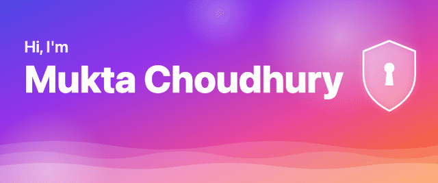

## About me

- 🛡️ I work in **AI security and compliance** at Adtecher, assessing risks in AI-enabled applications and APIs.
- ☁️ I review **AWS controls** and track remediation and audit evidence with engineering teams.
- 🎓 **MSc Cyber Security and Artificial Intelligence** (Merit), University of Sheffield.

<picture>
  <source media="(max-width: 600px)" srcset="assets/frameworks-sm.svg">
  
</picture>

## Let's connect

