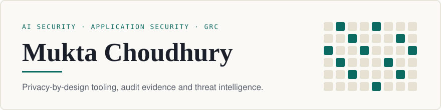
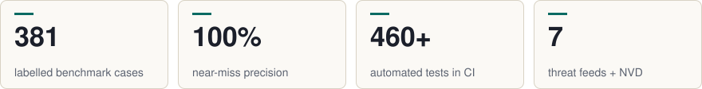
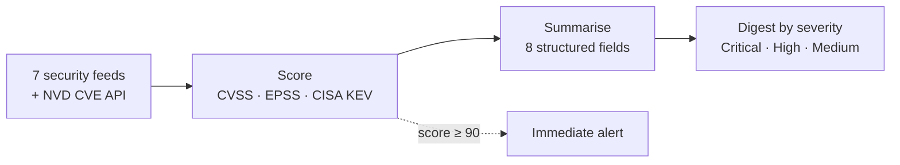

<picture>
  <source media="(prefers-color-scheme: dark) and (max-width: 600px)" srcset="assets/banner-sm-dark.svg">
  <source media="(max-width: 600px)" srcset="assets/banner-sm-light.svg">
  <source media="(prefers-color-scheme: dark)" srcset="assets/banner-dark.svg">
  
</picture>

I work in AI security and compliance at Adtecher. I assess risks in AI-enabled applications and APIs, review AWS controls, and track remediation and audit evidence with engineering teams. I also build open-source security tooling: privacy checks that run before code ships, and a threat-intelligence feed that ranks vulnerabilities by exploitability.

[Portfolio and case studies](https://mukta2701.github.io/) · [LinkedIn](https://www.linkedin.com/in/mukta-choudhury/)

## What I do

| Area | What it looks like in practice |
|---|---|
| **Application security** | Pre-commit and CI checks that stop personal data and secrets reaching logs, AI prompts and third-party services. |
| **Governance, risk and compliance** | Control mapping, risk assessment and audit evidence across ISO 27001, SOC 2 and AWS. |
| **Threat intelligence** | Prioritising vulnerabilities by exploitability (CVSS, EPSS, CISA KEV) instead of headline severity. |

<picture>
  <source media="(prefers-color-scheme: dark) and (max-width: 600px)" srcset="assets/metrics-sm-dark.svg">
  <source media="(max-width: 600px)" srcset="assets/metrics-sm-light.svg">
  <source media="(prefers-color-scheme: dark)" srcset="assets/metrics-dark.svg">
  
</picture>

Figures come from the READMEs of [privacy-review-agent](https://github.com/mukta2701/privacy-review-agent#-accuracy-measured-not-guessed) and [cybertrend-intelligence](https://github.com/mukta2701/cybertrend-intelligence).

## Featured work

### [Privacy Review Agent](https://github.com/mukta2701/privacy-review-agent)
**An offline privacy check for code before it ships.** It finds personal data reaching logs, AI prompts, analytics and third-party services, and flags hard-coded secrets, at `git commit` or in CI. It uses Semgrep to trace how sensitive data moves through code. Accuracy is a release gate: 203 of the 381 benchmark cases are deliberate look-alikes, so it is tested on what it should *not* flag. Structurally confirmed findings block a commit and keyword-only matches surface as warnings.

### [Cybertrend Intelligence](https://github.com/mukta2701/cybertrend-intelligence)
**A daily threat-intelligence digest ranked by exploitability.** It pulls from seven security feeds and the NVD CVE API, scores each item using CVSS, EPSS, CISA KEV and exploit evidence, summarises it into structured fields, and emails a digest grouped by severity. Critical items scoring 90 or above trigger an immediate alert.

### [Threat model: RFID implantable medical devices](https://github.com/mukta2701/rfid-threat-modelling-imd)
**A threat model for RFID-based implantable medical devices**, built with STRIDE and the OWASP approach.

## Frameworks I work with

| Used for | Frameworks |
|---|---|
| Building controls and audit evidence | ISO 27001 · SOC 2 |
| Assessing AI systems | EU AI Act |
| Privacy and data protection | GDPR (see [Privacy Review Agent](https://github.com/mukta2701/privacy-review-agent)) |
| Threat modelling and testing | STRIDE · OWASP (see [the RFID threat model](https://github.com/mukta2701/rfid-threat-modelling-imd)) |

## Background

**Postgraduate studies in Cyber Security and Artificial Intelligence**, University of Sheffield · Merit

Older learning projects

- [ChatBot-using-Python-and-NLTK](https://github.com/mukta2701/ChatBot-using-Python-and-NLTK): a simple intent-based chatbot built with Python, Keras and NLTK.
- [Java-Programming](https://github.com/mukta2701/Java-Programming), [Computer-Programming](https://github.com/mukta2701/Computer-Programming) and [Web-Technologies](https://github.com/mukta2701/Web-Technologies): earlier programming and web projects (2020–2022).

